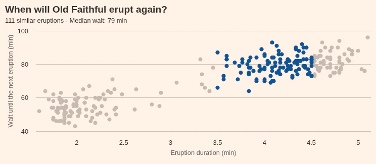
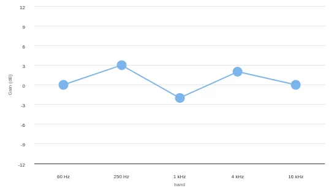
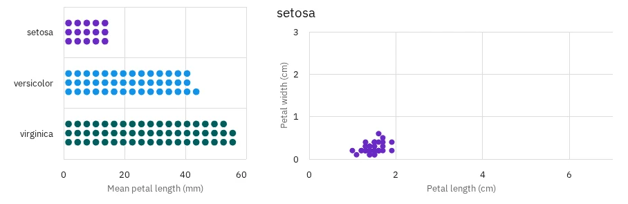
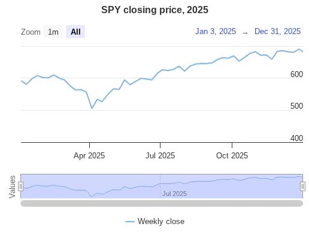

# Shiny gallery

Open an app to run R in your browser. The first launch downloads R and
the required packages. The [Shiny
walkthrough](https://jkunst.com/highcharter/articles/shiny.md) explains
the code behind the examples.

## Iris explorer

Switch between sepal and petal measurements for 150 flowers.

## Air passengers

Add a month and switch between a line and columns using a Shiny proxy.

## Equalizer

Select a frequency and drag its point to change the gain in decibels.

## Linked charts

Click a species to explore its individual flowers in a second chart.

## Stock prices

Zoom from weekly SPY closes to daily prices for the selected dates.
