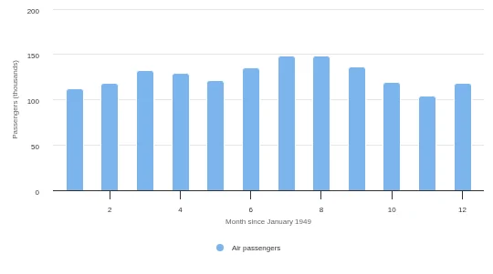
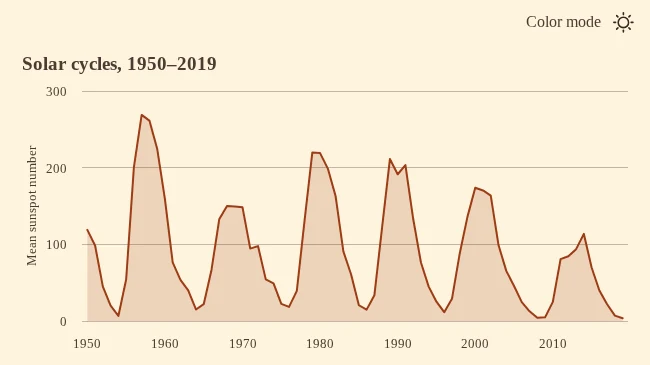

# Shiny gallery

Open an app in a new tab to run R in your browser. The first launch
downloads R and the required packages. The [Shiny
walkthrough](https://jkunst.com/highcharter/articles/shiny.md) explains
the code behind the examples.

## Old Faithful

Choose an eruption duration to see how long visitors waited for the next
eruption.

## Proxy playground

Compare cities, extend a passenger forecast, or rearrange an item chart
using Shiny proxies.

## Equalizer

Drag a frequency band and compare its live gain with the final value on
release.

## Linked charts

Hover or click a species in the dotplot to see its flowers in the same
color.

## Stock prices

Zoom from weekly SPY closes to daily prices for the selected dates.

## Solar cycles

Switch the observatory from daylight to night to see the chart inherit
the app’s theme.
